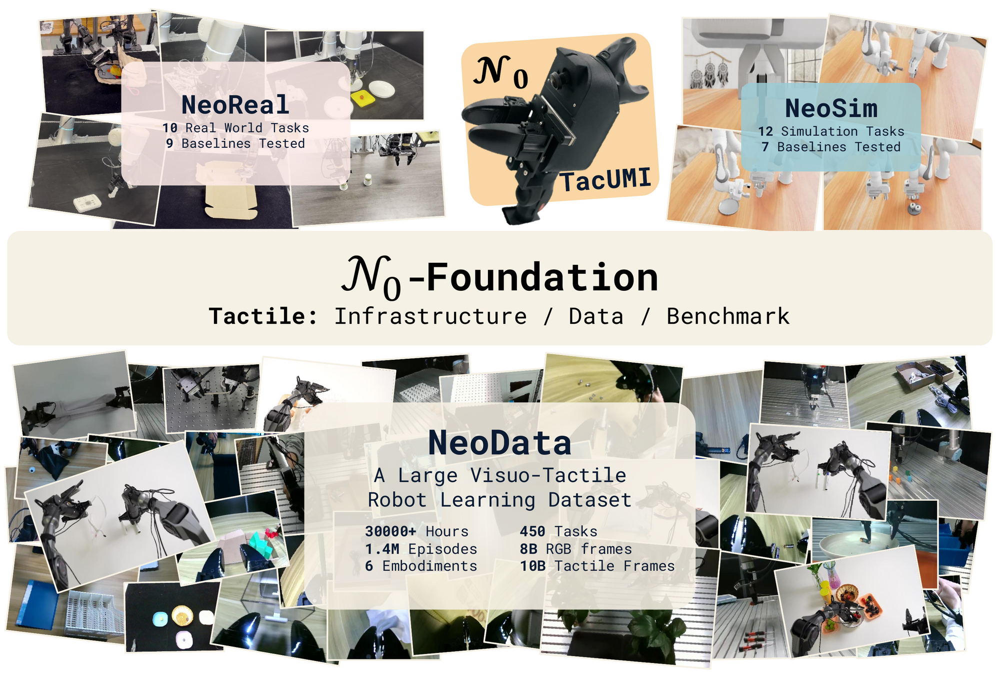
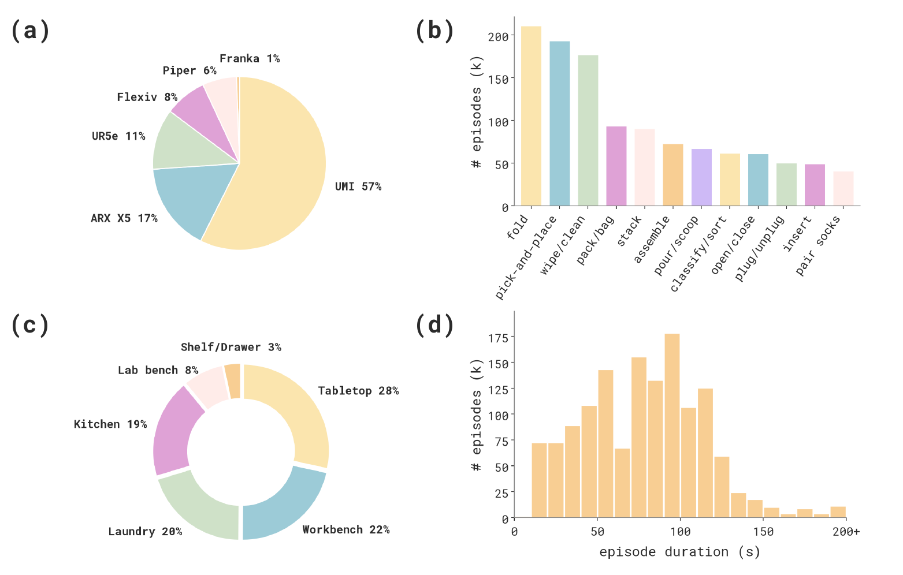
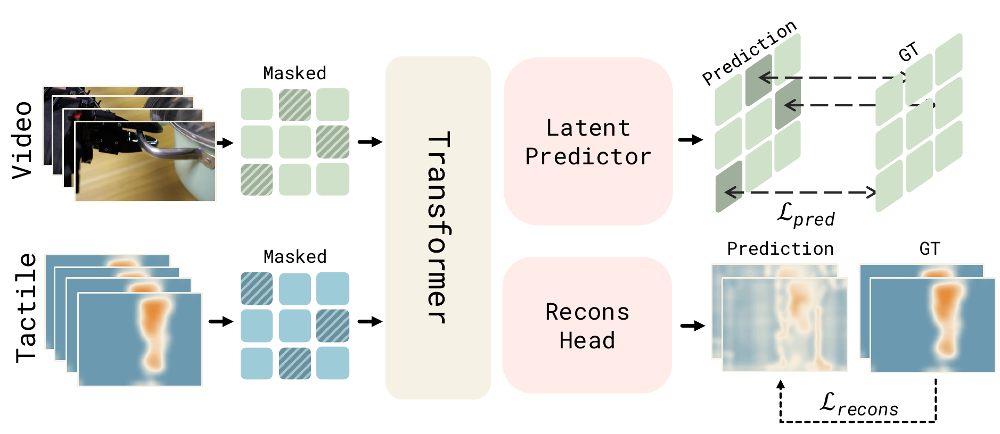
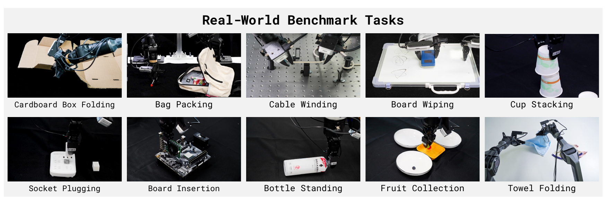
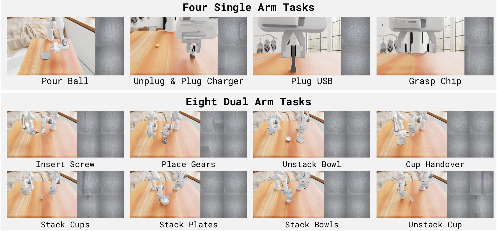

<h1 align="center">𝒩<sub>0</sub>-Foundation: Towards the Age of Tactile Intelligence</h1>

<p align="center">
  <a href="https://research.neoteai.com/assets/n0-foundation-paper.pdf"></a>
  <a href="http://research.neoteai.com/n0-foundation"></a>
  <a href="https://huggingface.co/datasets/NeoteAIEmbodied/OpenNeoData"></a>
  <a href="https://modelscope.cn/datasets/NeoteAI/OpenNeoData"></a>
</p>

## Overview

<p align="center">
  
</p>

Contact states, local forces, and incipient slip are rarely observable from vision alone, yet they are critical for deformable object manipulation, precise assembly, delicate force control, and sustained surface interaction. **𝒩<sub>0</sub>-Foundation** (read as *Neo-Foundation*) is a tactile-centric paradigm for embodied manipulation that treats infrastructure, data, representation, and evaluation as one system rather than four separate artifacts.

- **Tactile infrastructure** — durable vision based tactile sensors, **𝒩<sub>0</sub>-TacUMI** (a sensor integrated Universal Manipulation Interface device for robot-free collection), and a synchronized visual–tactile data collection system covering both multi-embodiment teleoperation and handheld demonstrations.
- **NeoData** — a large scale multimodal dataset with more than **30,000 hours** of synchronized visual and tactile demonstrations, spanning **six embodiments**, **450 tasks**, **1.4M episodes**, **8B RGB frames**, and **10B tactile frames**, collected through a mixture of real robot teleoperation and 𝒩<sub>0</sub>-TacUMI demonstrations. **OpenNeoData**, a **5,000 hour** open source subset covering six embodiments, 250+ tasks, and 200+ skills, is released for open research.
- **NeoForce** — a unified force based tactile representation. Every tactile observation is described as a dense three axis force field over the sensing surface, giving a hardware agnostic interface, and NeoForce is the visuo-tactile model that learns transferable, temporally structured tactile features from these force fields for downstream embodied policies.
- **Standardized evaluation** — the real world **NeoReal** suite (10 tasks, 9 baselines) and the simulated **NeoSim** suite (12 tasks, 7 baselines) for contact-rich manipulation.

### Roadmap

| Stage | Contents | Status |
| :--- | :--- | :---: |
| **Dataset** | OpenNeoData — 5,000 hour open source subset, with loaders and documentation | ✅ [Released](https://huggingface.co/datasets/NeoteAIEmbodied/OpenNeoData) |
| **NeoForce** | Unified force based tactile representation, with training and evaluation code | ✅ [Released](./neoforce) |
| **NeoSim** | Simulation suite: 12 contact-rich tasks, collection and evaluation pipeline | ✅ [Released](https://github.com/neoteai/NeoSim) |

## NeoData

We build NeoData, one of the largest tactile-enabled real-world manipulation corpora to date. Every episode carries synchronized visual and tactile streams, collected across five robot platforms and the handheld 𝒩<sub>0</sub>-TacUMI device, then curated through staged quality checks and annotated with a four level task hierarchy.

<p align="center">
  
</p>

The corpus is deliberately broad along every axis that matters for contact-rich manipulation: (a) six embodiments, with scalable handheld collection contributing the majority of trajectories and real robot teleoperation anchoring the corpus in executable behavior, (b) tactile-relevant skills such as folding, wiping, stacking, assembling, and inserting, (c) everyday scenes from tabletop and workbench to laundry and kitchen, and (d) episode durations that span both short contact primitives and long multistep interactions.

We further release **[OpenNeoData](https://huggingface.co/datasets/NeoteAIEmbodied/OpenNeoData)**, a 5,000 hour open source subset of NeoData covering six embodiments, more than 250 tasks, and over 200 skills, as an accessible entry point to the full corpus.

## NeoForce

<p align="center">
  
</p>

Tactile hardware is fragmented, so a model built on one signal format is bound to the device that produced it. We instead describe every tactile observation as a **dense three axis force field** over the sensing surface, capturing shear and pressure in a form that is physically grounded and shared across sensors. On top of it we build **NeoForce**, which fuses chunks of RGB observations and force fields into a temporally structured representation for downstream embodied policies, supervised jointly by force field reconstruction and latent prediction.

## Evaluation Suites

### NeoReal

<p align="center">
  
</p>

NeoReal measures policy performance under real physical interaction. We define 10 contact-rich tasks on robots equipped with tactile fingers, covering deformable object shaping, force-guided mating, delicate grasping, sustained surface contact, cable routing, stacking, insertion, and bimanual folding. Each task comes with a standardized initial state distribution, reset protocol, and success criterion.

### NeoSim

<p align="center">
  
</p>

**[NeoSim](./neosim)** provides a reproducible simulated arena for tactile-aware evaluation at scale. We build 12 contact-rich single arm and dual arm tasks that render per-contact force fields in the same format as the unified representation, so force-conditioned policies can be evaluated in simulation with the representation used for real tactile data.


## Citation

If you find our work useful in your research, please cite:

```bibtex
@article{team2026mathcal,
  title={$$\backslash$mathcal $\{$N$\}$ \_0 $-Foundation: Towards the Age of Tactile Intelligence},
  author={Team, NeoteAI and Fudan TEAI Team and others},
  journal={arXiv preprint arXiv:2608.29601},
  year={2026}
}
```
