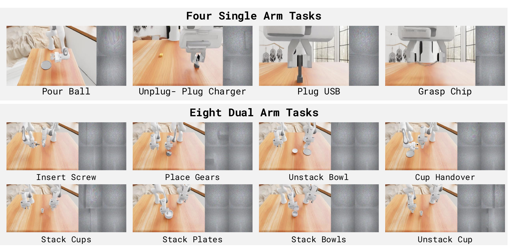

<h1 align="center">NeoSim</h1>

> **NeoSim** — the simulation suite of **NeoBenchmark** (N₀-Foundation): a reproducible arena for tactile-aware manipulation evaluation at scale.<br>
<p align="center">
  <a href="https://research.neoteai.com/assets/n0-foundation-paper.pdf"></a>
  <a href="http://research.neoteai.com/n0-foundation"></a>
  <a href="https://huggingface.co/datasets/NeoteAIEmbodied/OpenNeoData"></a>
  <a href="https://modelscope.cn/datasets/NeoteAI/OpenNeoData"></a>
</p>

**NeoSim** is the simulation counterpart of the real-world **NeoReal** suite in NeoBenchmark. It provides controlled, reproducible, large-scale evaluation of contact-rich manipulation — force regulation, delicate grasping, tight-clearance insertion, bimanual coordination, handover, and nesting — with high-fidelity tactile feedback from simulated GelSight-class sensors. NeoSim performs high-precision tactile data collection in simulation and renders **per-contact force fields in the same (x, y, z) surface-force format as the unified tactile representation (UniTF)** used for real tactile data, so force-based policies evaluate in simulation with the same representation they consume in the real world. It also provides the marker-less **particle gel image** representation (`gel_particle`).

NeoSim is **built on top of [UniVTAC](https://arxiv.org/abs/2602.10093)** (which itself builds on **NVIDIA Isaac Lab** and **TacEx**, a UIPC-based tactile simulation); expert demonstration collection and policy-server evaluation share one framework.

## Attribution

This repository is a **derivative work of [UniVTAC](https://github.com/byml-c/UniVTAC)** by Chen et al. (arXiv:2602.10093; original datasets: [HuggingFace](https://huggingface.co/datasets/byml/UniVTAC) / [ModelScope](https://modelscope.cn/datasets/byml2024/UniVTAC)), used and modified under the MIT License. Major modifications in NeoSim include: a new visuo-tactile representation (`gel_particle`) and force-field tooling; twelve additional tasks (four single-arm — `insert_USB`, `grasp_chip`, `pour_ball`, `phone_socket_replug` — and eight dual-arm) together with their procedurally generated assets (`scripts/asset_tools/`); revised and audited evaluation success criteria; additional task/eval configurations; and policy-server evaluation clients for multiple baselines. See [NOTICE](./NOTICE) for details, and please cite the UniVTAC paper (below) when using the underlying benchmark.

## Installation

See the [Installation Guide](./docs/Installation.md) for detailed setup instructions, including installing the environment, installing TacEx from the modified local source and setting up cuRobo for motion planning.

### Assets

Binary assets are distributed separately from the code and are not tracked in this repository. Download them from HuggingFace and unpack them in place, so the task environments resolve paths such as `assets/objects/USB.usd`. Two trees are involved:

```
neosim/assets/                      scene, object, embodiment and texture assets
├── embodiments/
├── objects/
├── scene/
└── textures/

neosim/third_party/TacEx/source/tacex_assets/tacex_assets/data/
├── Policies/                       robot, sensor and prop assets used by TacEx
├── Props/
├── Robots/
└── Sensors/
```

Only the meshes, textures, USD stages, calibration packs and policy checkpoints are external. The Python, URDF and JSON files living in the same directories are code and ship with the repository.

<!-- TODO(release): HuggingFace assets link -->

## Task Gallery

### NeoSim benchmark tasks (12)


*The 12 NeoSim benchmark tasks. For each task, the left panel shows the simulated RGB scene and the right panels visualize the particle gel images rendered from the tactile sensors.*

The NeoSim suite of NeoBenchmark contains **12 contact-rich tasks: 4 single-arm and 8 dual-arm**, spanning rigid objects, thin-walled containers, fragile parts, deformable contact, and tight-clearance assembly.

| Benchmark task | Module | Description |
|---|---|---|
| **Pour Ball** | `pour_ball` | Grasp a cup and pour the ball inside it out onto a plate (force-regulated carry & tilt) |
| **Unplug & Plug Charger** | `phone_socket_replug` | Pull a charger plug out of its socket and re-insert it into another |
| **Plug USB** | `insert_USB` | Peg-in-hole insertion of a USB connector into a slot |
| **Grasp Chip** | `grasp_chip` | Grasp a fragile chip without crushing it (tactile force limit) |
| **Insert Screw** | `dual_screw_sleeve` | One arm holds the sleeve, the other inserts a screw into its bore |
| **Place Gears** | `dual_gear_holder` | Pick gears and thread each onto one of the holder's vertical pegs |
| **Unstack Bowl** | `dual_bowl_unstack` | Grasp the top bowl of a nested pair by its rim, lift it out, set it aside |
| **Cup Handover** | `dual_cup_handover_place` | One arm grasps a cup, hands it to the other arm, which places it |
| **Stack Cups** | `dual_cup_place_stack` | Bring two separated cups together into a centered nested stack |
| **Stack Plates** | `dual_plate_place_stack` | Bring two separated plates together into a centered stack |
| **Stack Bowls** | `dual_bowl_place_stack` | Bring two separated bowls together into a centered nested stack |
| **Unstack Cup** | `dual_cup_unstack` | Grasp the top cup of a nested pair, lift it out, set it aside |

### Additional tasks (inherited from UniVTAC)

| Task | Module | Description |
|---|---|---|
| **Lift Bottle** | `lift_bottle` | Grasp and lift a bottle off a surface near a wall |
| **Lift Can** | `lift_can` | Rotate a lying can so it stands upright |
| **Insert HDMI** | `insert_HDMI` | Insert an HDMI connector into a port |
| **Insert Hole** | `insert_hole` | Precision peg-in-hole insertion (tilted axis) |
| **Insert Tube** | `insert_tube` | Insert a tube into a tilted fixture |
| **Pull Out Key** | `pull_out_key` | Untwist and extract a key from a lock |
| **Put Bottle in Shelf** | `put_bottle_in_shelf` | Reorient a bottle upright and place it on a shelf |
| **Grasp & Classify** | `grasp_classify` | Grasp an object and classify it by tactile texture |

(`envs/collect.py` is a contact-rich data-collection environment for tactile pretraining — not a benchmark task.)

Per-task action flows and the **exact success criteria** (with code references) are documented in [Tasks](./docs/Tasks.md); each `envs/<task>.py` links to its section. To build more tasks, refer to the [Task Creation Guide](./docs/TaskCreation.md) — including dual-arm tasks, rigid in-hand "weld" carrying, rim grasps for wide objects, and peg insertion. For the asset side (mesh → simulation-ready USD with baked tets), see the [Asset Pipeline](./docs/AssetPipeline.md).

## Tactile Representations

NeoSim produces three tactile output families per gel pad — **GelSight images** (`rgb`/`rgb_marker`/`depth`/`marker`), **force values** (lossless per-vertex forces with offline `force_field` reconstruction — the same (x, y, z) surface-force format as the unified tactile representation, UniTF), and the marker-less **particle gel image** (`gel_particle`) shown in the N₀-Foundation report's NeoSim figures. All are selected per-collection in the task config; see [Tactile Representations](./docs/TactileRepresentations.md).

## Data Collection

See the [Data Collection Guide](./docs/Collection.md) for instructions on how to run the automated data collection pipeline, configure task-specific parameters, and understand the output data structure.

The original UniVTAC dataset (100 episodes per upstream task) can be downloaded from [HuggingFace](https://huggingface.co/datasets/byml/UniVTAC), [ModelScope](https://modelscope.cn/datasets/byml2024/UniVTAC) or via `data/download.sh`. <!-- TODO(release): add NeoSim dataset link when published -->

## Visualizing Tasks & Saving Videos

Every task runs through the same entry point, `scripts/collect_data.py`, driven by a YAML config in `task_config/`. The config controls whether a video is recorded and whether an interactive Isaac Sim window opens.

```bash
python scripts/collect_data.py <task_name> <task_config> [--gpu <id>]
# e.g.
python scripts/collect_data.py insert_USB demo
```

- `<task_name>` — a module under `envs/` (e.g. `insert_USB`, `lift_can`, `dual_screw_sleeve`).
- `<task_config>` — a YAML under `task_config/` (extension optional, so `demo` resolves to `task_config/demo.yml`).

### Saving a task's video

Run the task with a config whose `video_frequency > 0`. The MP4 is written to:

```
data/<task_name>/<task_config>/video/<seed>_<result>.mp4
```

where `<result>` is `success`, `fail`, or `error` — so the clip is saved **no matter the outcome**. Each frame tiles the head + wrist camera views alongside the tactile-pad images.

Config keys that control recording (see `task_config/demo.yml` for a full example):

| Key | Meaning |
|---|---|
| `video_frequency` | `>0` enables MP4 recording (writes one frame every N steps); `0` disables it |
| `render_frequency` | `0` = headless (no window, pure recording); `1` = also open a live Isaac Sim window |
| `save_frequency` | cadence for saving HDF5 observations |
| `episode_num` | number of **successful** episodes to collect before stopping |
| `start_seed` / `max_seed` | first seed / seed cap (CLI `--start_seed` / `--max_seed` override the YAML) |
| `observations` | which `camera` / `tactile` / `embodiment` / `actor` signals to log |

To record a single **try shot** — run one seed exactly once at the highest frequency (a frame every step) and save the video whether it succeeds or fails — use the ready-made `task_config/record_one.yml` (`episode_num: 1`, `start_seed: 0`, `max_seed: 0`, `video_frequency: 1`):

```bash
python scripts/collect_data.py <task_name> record_one
# -> data/<task_name>/record_one/video/0_<result>.mp4
```

### Poster / figure view (third-person + tactile only)

By default each video frame tiles the head **and wrist** camera views next to the tactile pads. For figures or posters you often want only the third-person (head) view plus the tactile views, with the wrist cameras removed. Set `UNIVTAC_POSTER_VIEW=1` to drop the wrist panels:

```bash
UNIVTAC_POSTER_VIEW=1 python scripts/collect_data.py <task_name> record_one
```

The frame then contains **head + tactile** only and is sized to fit: single-arm tasks → `640x320` (head + 2 tactiles), dual-arm tasks → `800x320` (head + 4 tactiles). Everything else (which seeds run, where the MP4 is written) is unchanged.

### Visualizing in the Isaac Sim GUI

All three options below open the live Isaac Sim window and therefore require a display (`DISPLAY` set):

1. **Watch while collecting** — set `render_frequency: 1` in the config (see `task_config/gui.yml`). This opens an Isaac Sim window with live rendering as the scripted demo runs, and still records the video:
   ```bash
   python scripts/collect_data.py insert_USB gui
   ```
2. **Inspect a task scene** (robot + objects, no scripted motion) — handy while building or placing a new task:
   ```bash
   python scripts/view_task.py <task_name> [--seed <id>]   # e.g. python scripts/view_task.py insert_USB
   ```
3. **Inspect a single asset** (`.usd`) on a ground plane:
   ```bash
   python scripts/view_usd.py assets/objects/USB.usd
   ```

> **Multi-GPU / headless note:** Isaac Sim's renderer must run on an RTX NVIDIA GPU. On machines whose X display defaults to a non-NVIDIA GPU (e.g. an Intel iGPU), force the NVIDIA Vulkan driver before launching — this is also required for headless camera/video recording:
> ```bash
> VK_ICD_FILENAMES=/usr/share/vulkan/icd.d/nvidia_icd.json \
>   __NV_PRIME_RENDER_OFFLOAD=1 __GLX_VENDOR_LIBRARY_NAME=nvidia DISPLAY=:1 \
>   python scripts/collect_data.py insert_USB gui
> ```

## Train & Eval Policies

NeoSim supports two evaluation paths that coexist without interfering:

**(a) Local policies** (inherited from UniVTAC) — self-contained baselines under `policy/` (ACT with/without tactile, Ablation variants, ViTAL), each with its own data processing, training, and deployment scripts, driven by the original entry points:

```bash
bash eval_policy.sh ${task_name} ${task_config} ${policy_config} ${gpu_id}
bash parallel_eval.sh ${task_name} ${task_config} ${policy_config} ${gpu_id} [num_processes] [total_num]
```

**(b) Policy-server evaluation** (NeoSim's primary path) — the clients under `eval/` connect to a remote policy server over a WebSocket protocol (vendored client library in `eval/remote_infer_lib/`): the simulator streams observations (cameras + tactile) and receives action chunks. TWAM-style policies and the Pi0.5 / XR0 / giga baselines are all evaluated this way (`eval/eval_twam_ee_cl.py`, `eval/eval_*_cl.py`; driver `eval/run_eval.sh`).

Results from both paths land under `eval_result/<policy>/<task>/...` with per-seed `metadata.json`. To deploy your own policy, refer to [Deploy Your Policy](./docs/Deploy.md).


## 👍 Citations
If you use NeoSim, please cite the N₀-Foundation technical report:

```bibtex
@misc{n0foundation,
      title={N0-Foundation: Towards the Age of Tactile Intelligence},
      author={NeoteAI Team and TEAI Team},
      year={2026},
      url={https://research.neoteai.com/assets/n0-foundation-paper.pdf},
      note={Technical Report}
}
```

NeoSim builds on the UniVTAC simulator — please also cite:

```
@article{chen2026univtac,
  title={UniVTAC: A Unified Simulation Platform for Visuo-Tactile Manipulation Data Generation, Learning, and Benchmarking},
  author={Chen, Baijun and Wan, Weijie and Chen, Tianxing and Guo, Xianda and Xu, Congsheng and Qi, Yuanyang and Zhang, Haojie and Wu, Longyan and Xu, Tianling and Li, Zixuan and others},
  journal={arXiv preprint arXiv:2602.10093},
  year={2026}
}
```

## 🏷️ License
NeoSim is distributed under the [MIT License](./LICENSE), as is the UniVTAC work it derives from. Vendored third-party code under `third_party/` retains its own license (TacEx: MIT). See [NOTICE](./NOTICE).
