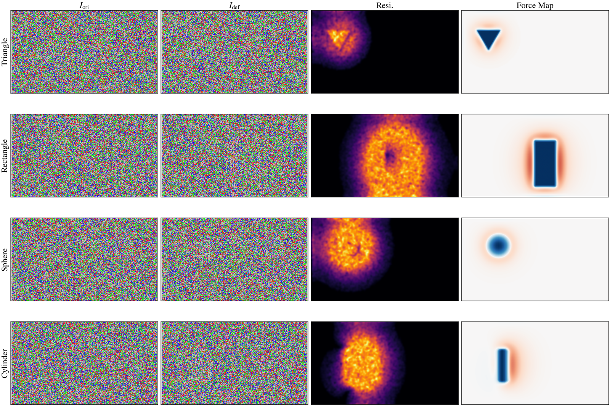

# Tactile Representations

NeoSim produces three families of tactile output per gel pad. Everything is selected per-collection via the task config; nothing requires code changes.

| Family | What it is | Obs keys | Format |
|---|---|---|---|
| **GelSight** (images) | Standard simulated GelSight imagery | `rgb` (clean optical), `rgb_marker` (with marker dots), `depth`, `marker` (marker positions) | `(T,240,320,3) u8` / `(T,H,W)` / `(T,2,64,2)` |
| **Force** (values) | Contact forces from the UIPC solver | `vertex_force` (sensor frame, lossless), `contact_force` (world frame), `force_field` (dense grid), `marker_force` (marker grid) | `(T,N_v,3)` / `(T,H,W,3)` / `(T,63,3)` |
| **Particle** (ours) | Marker-less gel image: silver base + flow-coupled particle coating | `gel_particle` | `(T,240,320,3) u8` |


*Four indenter shapes (triangle, rectangle, sphere, cylinder) pressed into the simulated gel: original particle coating image, deformed image, their residual, and the rendered force map.*

## Choosing what to store

The `observations.tactile` list in any `task_config/*.yml` is the selector — add the keys you want:

```yaml
sensor_type: gsmini
observations:
  tactile:
    - rgb              # GelSight: clean optical image (needed later for particle offline generation)
    - rgb_marker       # GelSight: with marker dots
    - depth            # GelSight: depth map
    - vertex_force     # Force: per-vertex, sensor frame (lossless; reconstruct any grid offline)
    - gel_particle     # Particle: marker-less gel image (in-loop variant)
```

- `gel_particle: true` at the top level is a convenience flag equivalent to appending `gel_particle` to the list (see `scripts/collect_data.py`).
- `task_config/demo.yml` already stores the full image family plus `gel_particle`; `task_config/collect_force.yml` stores the lossless force family. To store everything in one run, add `vertex_force` to the `tactile` list of your config.
- Recommended minimal lossless set: `rgb + rgb_marker + depth + marker + vertex_force` — from these, `gel_particle` and any `force_field` grid can be regenerated **offline** at any time (see below), so storing the derived representations during collection is optional.
- **Default configs collect `gel_particle` in-loop**: the stock `demo`/`*_collect` profiles under `task_config/` already include `gel_particle` in their tactile list, so particle images land in the dataset directly with no offline regeneration step. Remove the key from the list if you want leaner storage — offline regeneration stays available either way.
- `UNIVTAC_PANEL` (env) selects which representation is tiled into recorded videos: `particle` → `gel_particle`, `force` → `force_field_img`, default → `rgb_marker`.

---

## 1. GelSight images

Simulated GelSight Mini output via Taxim optics on the UIPC-deformed gel mesh:

- `rgb` — clean optical image, no marker dots. Keep it enabled if you ever want to generate `gel_particle` offline (the silver base is reconstructed from it).
- `rgb_marker` — same optics with the 9×7 marker dot layer; the classic GelSight look.
- `depth` — per-pixel gel indentation depth; also the source of the force-proxy `pressure = far_plane − get_min_depth()` used by force-limited tasks.
- `marker` — marker positions `(T,2,64,2)` (current & rest), the raw signal behind marker-motion shear.

---

## 2. Force values

Lossless per-vertex contact forces stored at collection time; dense grids reconstructed **offline** — the RAW → develop workflow: run the expensive simulation once, re-derive grid representations at any time.

> **⚠️ Dependency.** All force representations rely on `UipcSim.get_contact_gradient()` (called from `envs/sensors/tactile.py`), defined in the vendored TacEx copy at `third_party/TacEx/source/tacex_uipc/tacex_uipc/sim/uipc_sim.py`. It reads the Geometry produced by `ContactSystemFeature.contact_gradient` — `inst.find("i")` (vertex indices) and `inst.find("grad")` (gradients) — with **per-vertex contact force ≈ −grad** (world frame, GlobalVertexManager indexing). On a fresh environment, verify: `python -c "from tacex_uipc.sim import UipcSim; print(hasattr(UipcSim, 'get_contact_gradient'))"`. A missing method raises `AttributeError`; guessing at attribute names instead would produce **silently wrong forces**.

### Representations

| obs key | Shape | Description | Interpolated |
|---|---|---|---|
| `contact_force` | `(T, N_v, 3)` | Per-vertex force, **world frame** (raw solver output, sparse) | No |
| `vertex_force` | `(T, N_v, 3)` | Per-vertex force, **sensor frame** (xy = shear, z = normal). **Store this** | No |
| `force_field` | `(T, H, W, 3)` | Dense grid (default `48×64`): barycentric interpolation of vertex forces, sensor frame | Yes |
| `marker_force` | `(T, 63, 3)` | Forces at the 9×7 marker grid, sensor frame | Yes |

`N_v` = gel mesh vertices: coarse **169**, dense **615**.

### Collection

Use `task_config/collect_force.yml` (or your own) — put `vertex_force` under `tactile`, omit `force_field` / image variants:

```yaml
sensor_type: gsmini
dense_gelpad: false        # false = coarse 169 (fast); true = dense 615 (~1.8x fidelity, ~2.6x cost)
force_field_grid: [64, 48] # output grid (W,H); mesh-scale grids like [16,12] recommended for learning
observations:
  tactile: [rgb_marker, depth, vertex_force]
```

Collection writes `ff_meta_<gel>.npz` next to the HDF5s — the grid↔mesh barycentric binding required for offline reconstruction (mesh-fixed, seed-independent). **Do not delete.**

### Offline reconstruction (no GPU / Isaac)

```bash
# whole run directory (recursive) or a single file:
python scripts/tactile_tools/contact_force_to_field.py <save_dir>/<task>/collect_force
python scripts/tactile_tools/contact_force_to_field.py path/to/0.hdf5 --grid 16 12
# optional: --out-key <name> (default force_field), --meta-dir <dir with ff_meta files>
```

The same `vertex_force` reconstructs **any grid at any time** without re-collection. Offline output is identical to the in-loop computation (element-wise error ~1e-10, verified): `force_field` is a barycentric interpolation, and since `vertex_force` is stored in the sensor frame, interpolation and rotation commute.

### Reading

```python
import h5py
f = h5py.File("0.hdf5", "r")
ff = f["tactile/left_tactile/force_field"][:]   # (T, 48, 64, 3) float32; (fx,fy,fz) sensor frame
vf = f["tactile/left_tactile/vertex_force"][:]  # (T, N_v, 3) raw per-vertex forces
```

Layout is H×W×3 (48 rows × 64 cols); units follow the UIPC contact gradient (calibration to newtons is material/scale-dependent).

### Fidelity: mesh density vs. grid size (do not conflate)

- **`dense_gelpad`** = mesh density = true resolution — **the only knob that adds information**. Coarse 169 (~40 peak contact vertices, 1×) vs dense 615 (~74, ≈1.8× fidelity, ~2.6× cost). The dense mesh needs a one-time asset build: `python scripts/asset_tools/make_dense_gelpad.py` (its surface extraction is corrected to the gel's local frame; without that fix `force_field` degenerates to zeros once the gripper pose changes).
- **`force_field_grid`** = output shape — adds no information. A `64×48 = 3072` grid far exceeds the mesh's effective resolution (~9–14 even when dense), so most of it is upsampling/zeros — redundant for learning. **Feed networks a mesh-scale grid (e.g. `[16,12]`)** and standardize the three channels per channel (raw values are ~1e-4); upsample offline if a larger shape is needed.
- Storing `force_field_img` images during production collection is discouraged (~16× larger than the values, zero extra information); render visualizations offline from the stored values instead.

---

## 3. Particle (`gel_particle`, ours)

A **marker-less** visuo-tactile image: silver gel base + fine colored **particle coating** that **flows** under contact (tangentially from marker motion, normally from indentation), plus a subtle contact shadow. Same resolution as the marker images: `(T,240,320,3) u8`.

Rendering recipe (`get_gel_particle_image` in `envs/sensors/tactile.py`; offline script below):

1. **Silver base** — from the clean `rgb` luminance: `g0 = clip(172 + (lum − mean)·1.1, 128, 214)`, slight cool tint + gray noise.
2. **Particle coating** — dense 1-px colored speckles (saturation 120–210), alpha-composited.
3. **Flow (key step)** — the coating is advected by `I(x) = coating(x − D(x))` with **tangential + normal** displacement:
   - *Tangential*: per-marker displacement (current − rest, rigid motion removed) densified via normalized convolution → shear/drag streaks;
   - *Normal*: indentation gradient `−∇(indent)·bulge` (`indent = rest depth − depth`) → particles pushed outward as the probe presses in (gel bulging). Without it, press-dominant tasks (e.g. `grasp_chip`, ~5 px tangential) show almost no particle motion.
4. **Contact shadow** — `out ·= 1 − 0.10·norm(depth)`, subtle.

### Option A: live during collection

`gel_particle: true` in the config (or add `gel_particle` to `observations.tactile`). Example: `task_config/lc_marker_gp.yml`.

### Option B: offline on existing data (recommended — no re-collection)

Requires `rgb` + `marker` + `depth` per gel (stored by default):

```bash
conda activate UniVTAC   # numpy / opencv / h5py only; no Isaac / GPU
python scripts/tactile_tools/add_gel_particle_offline.py IN.hdf5 --preview /tmp/gp.png  # look first
python scripts/tactile_tools/add_gel_particle_offline.py IN.hdf5 --inplace              # write back
python scripts/tactile_tools/add_gel_particle_offline.py IN.hdf5 --out OUT.hdf5         # or to a copy
```

- `--gels auto` (default) processes **all** gels, including the four dual-arm pads (`left/right_tactile` + `_b`).
- `--bulge 0.5` (default) scales the normal flow; `0` disables it.
- ⚠️ `--inplace` **overwrites** an existing `gel_particle` (e.g. from an older recipe without normal-flow coupling — worth regenerating). Use `--out` to keep the original.

Batch: `for h in $(find data/<task>/<collect>/hdf5 -name '*.hdf5'); do python scripts/tactile_tools/add_gel_particle_offline.py "$h" --inplace; done`

### FAQ

- **Only `rgb_marker`, no clean `rgb`?** The silver base needs clean `rgb`; marker dots would bleed into it. Keep `rgb` enabled during collection.
- **Numeric forces instead of images?** That's the Force family above — a separate signal; `gel_particle` contains no calibrated force.
